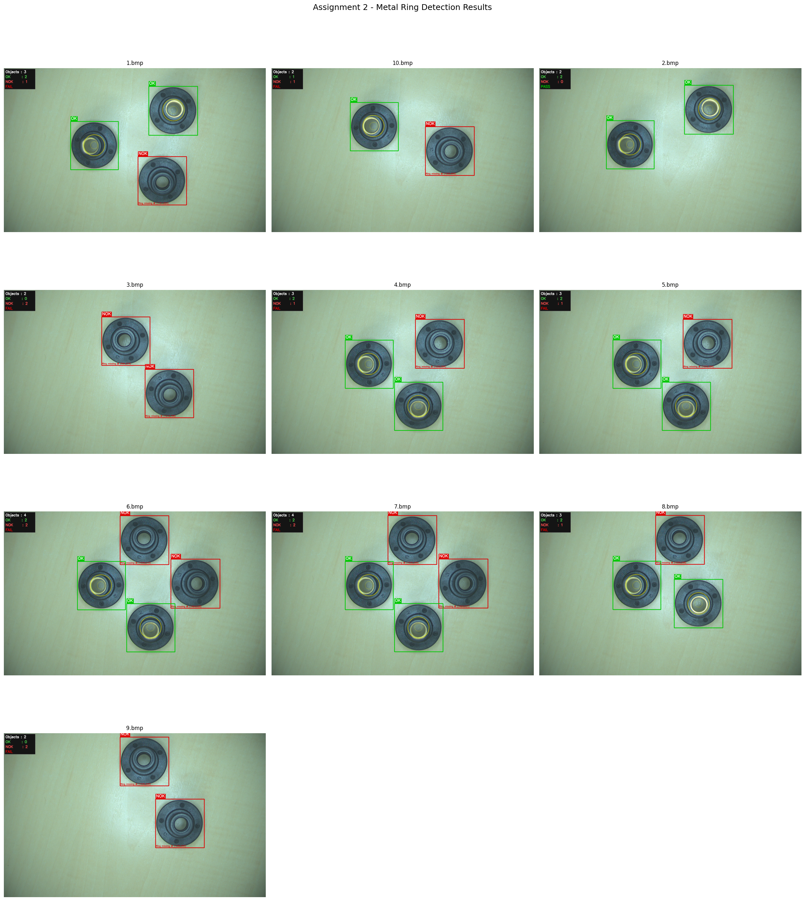
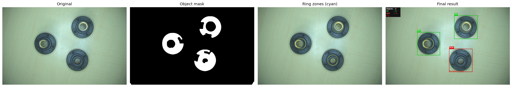

# Metal Ring Inspection — Machine Vision

An optical inspection system that detects whether a **metal ring is present** on a plastic product moving on a conveyor belt. Each part is marked **OK** (ring present) or **NOK** (ring missing), with a bounding box and the defect position for NOK parts.

University project: *Machine Vision System Design (Project 03), Assignment 2*. The full design and calculations are in [`Assignment2_Metal_Ring_Report.pdf`](Assignment2_Metal_Ring_Report.pdf).



## Task

- Products move on a 7 cm wide belt at 100 mm/s. Several products can be in one image, but they do not touch.
- Find the maximum exposure time so that motion blur is at most 1 pixel.
- Classify each product as OK or NOK, draw a bounding rectangle, and report the defect location for NOK parts.

## Optical setup

| Component | Selection |
|---|---|
| Camera | Basler acA1920-40gc (1920 × 1200 px, 5.86 µm pixel) |
| Lens | 12 mm C-mount, aperture f/4 |
| Lighting | White LED ring light (front, bright-field) |
| Working distance | 190 mm |
| Field of view | about 167 × 104 mm (covers the 70 mm belt) |
| Scene pixel size | 0.087 mm/px (checked with a reference object in Pylon Viewer) |
| Max. exposure time | 869 µs (1 pixel of motion blur at 100 mm/s) |

## Method

The ring is detected by colour in a ring-shaped zone of each object:

1. **Segment objects:** grayscale, Gaussian blur, inverted thresholds (75, 95, 115), morphological closing and opening, contour filter (area, circularity, aspect ratio), and removal of duplicate detections.
2. **Define the ring zone:** the annular region from 18% to 50% of the object radius, around the object centre.
3. **Detect the metal ring:** convert to HSV and count gold/brass pixels (hue 20–70, saturation ≥ 35, value ≥ 50) inside the ring zone only.
4. **Classify:** gold ratio ≥ 0.15 is **OK**; below 0.15 is **NOK**.
5. **Draw the output:** green box for OK, red box for NOK, label, ring-zone circles, "Ring missing at (x, y)" for NOK parts, and a summary panel with a PASS/FAIL verdict.

Other approaches I tested and rejected: full-object colour detection, Hough circle completeness, and contour hierarchy. The plastic cap alone already produced circles and nested contours, so these methods could not separate OK from NOK.

## Results

10 lab images with 1–4 objects each (28 objects in total: 15 OK, 13 NOK). In the report, the gold ratio was 0.40–0.55 for OK parts and below 0.08 for NOK parts, so the 0.15 threshold gave a large margin and every object was classified correctly in these images.

This is a small test set from one lab setup. It is not a full accuracy evaluation.



## Run it

**Requirements:** Python 3, `opencv-python`, `numpy`, `matplotlib`, Jupyter.

```bash
pip install opencv-python numpy matplotlib jupyter
```

1. Extract `images.zip` so that the folder `images/input/` is next to the notebook.
2. Open `Assignment2_MetalRing_Final.ipynb` in Jupyter.
3. Choose **Run All**.
4. Annotated images are saved to `images/output/`, the overview to `results_overview.png`, and the per-image OK/NOK counts are in the summary table.

### Settings you can tune (Section 3 of the notebook)

| Setting | Default | When to change |
|---|---|---|
| `GOLD_RATIO_THRESH` | 0.15 | Lower it if OK parts are called NOK; raise it for the opposite |
| `DARK_THRESHOLDS` | [75, 95, 115] | Lower if objects blend with the background |
| `RING_INNER_FRAC` / `RING_OUTER_FRAC` | 0.18 / 0.50 | Adjust if the ring sits closer to the centre or is large |
| `GOLD_HUE_MIN/MAX` | 20 / 70 | Change for other ring colours |

## Tools

Python · OpenCV · NumPy · Matplotlib · Jupyter Notebook · Basler Pylon Viewer

## Author

Oshan Disanayaka — [LinkedIn](https://www.linkedin.com/in/oshan-disanayaka-45b4b211b/)
